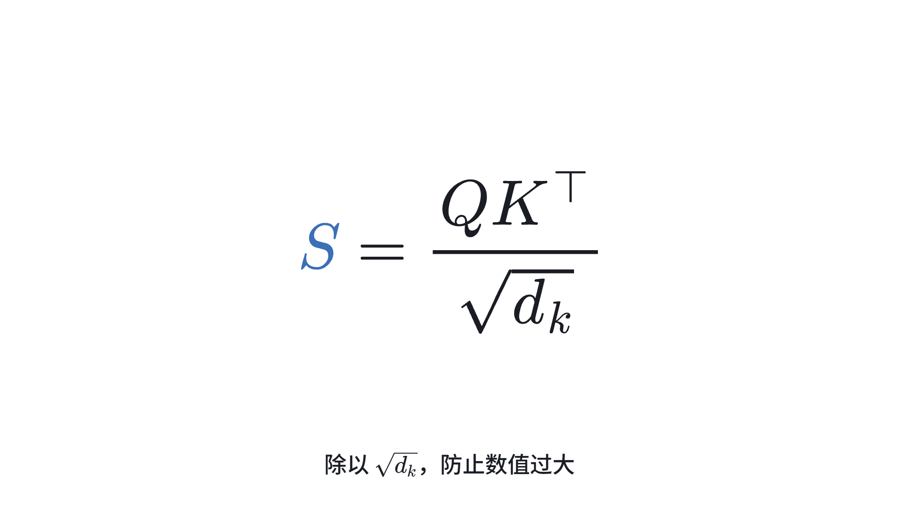
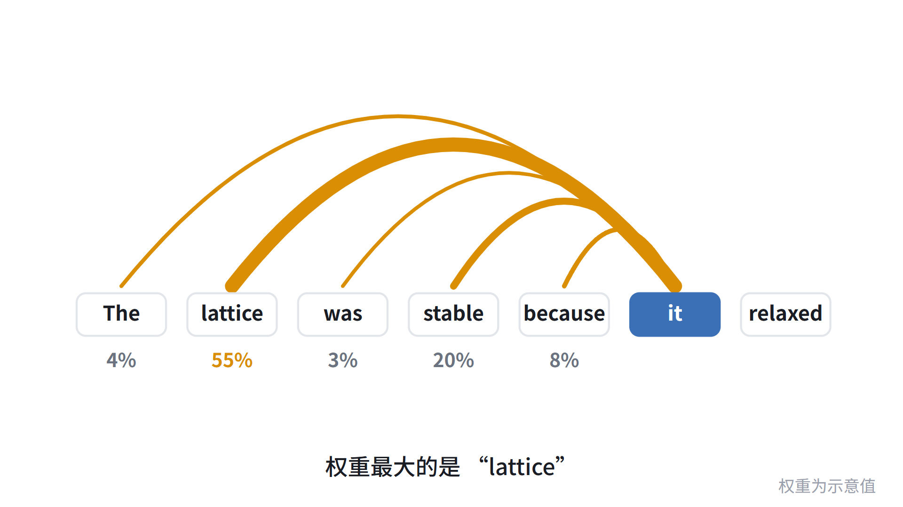
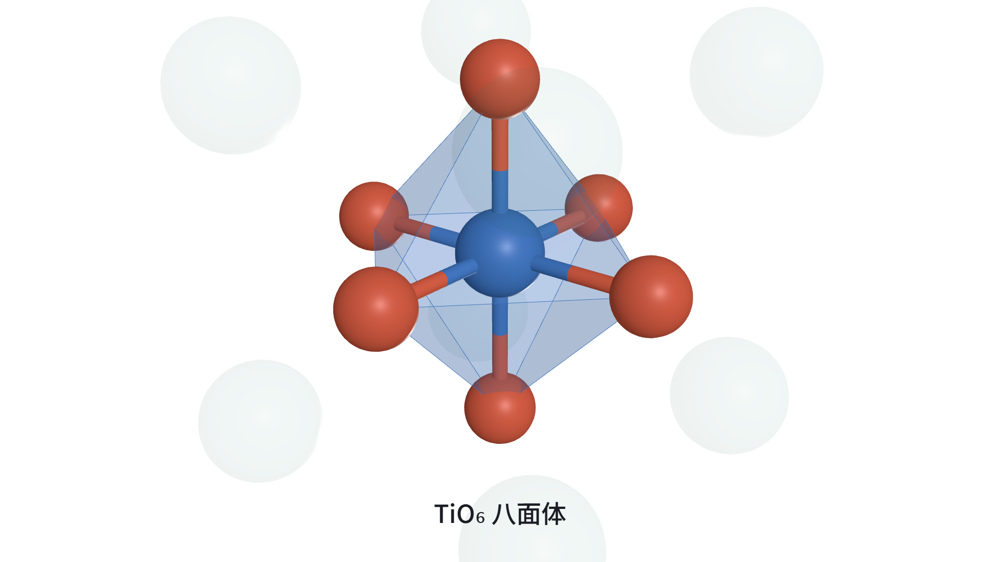
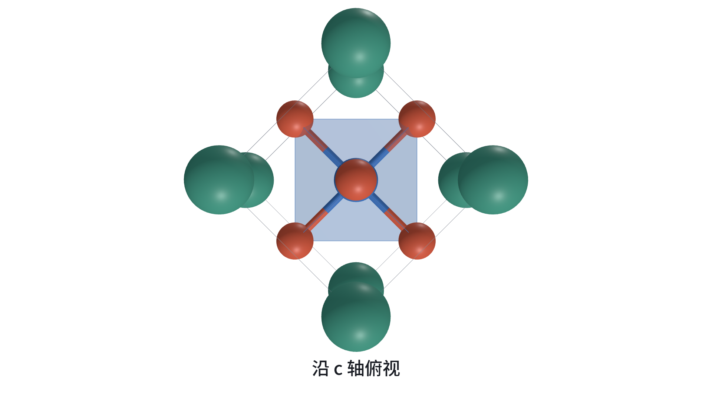
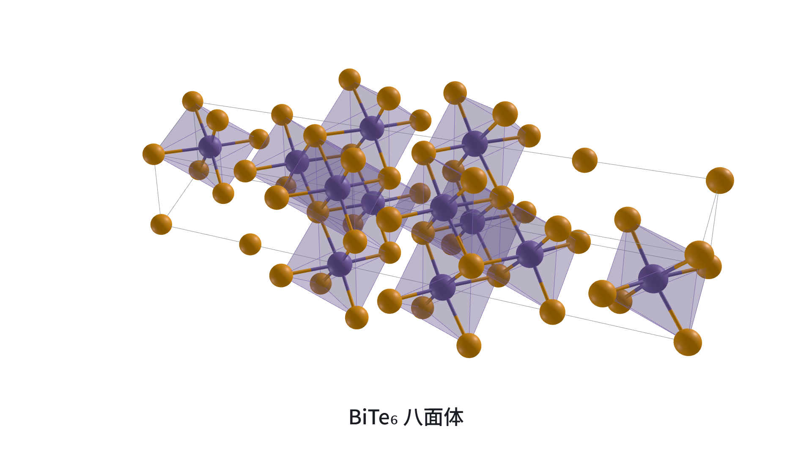
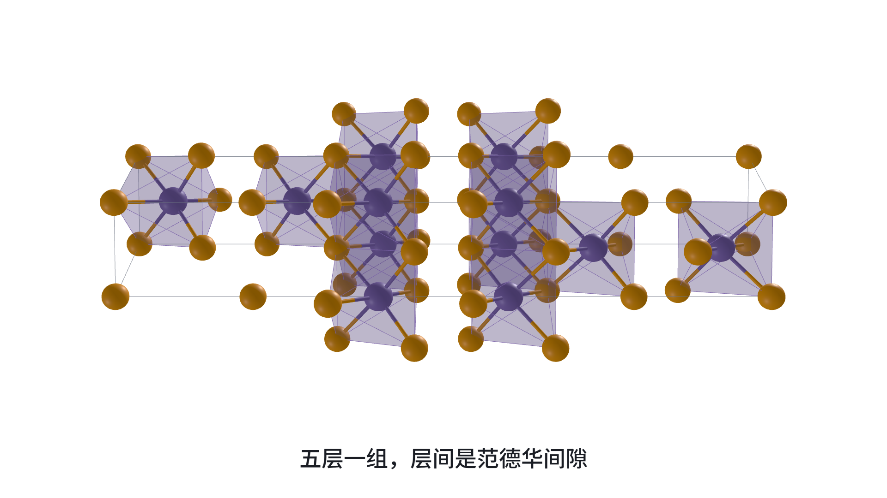

# manim-materials-slides

大模型 × 材料 方向的演示模板：3b1b 式版面，白底，点击一步一步演，可回退。
TypeScript + Vite，动画用 [manim-web](https://github.com/maloyan/manim-web)，3D 晶体用 three.js。

```bash
npm install
npm run dev        # http://localhost:4100
npm run build      # 类型检查 + 构建到 dist/，可离线放映（需静态服务器）
npm test           # 单元测试
npm run check      # 无头浏览器逐页逐步检查（控制台错误 + 跳转/点击两种路径画面一致）
npm run shots      # 重新生成 README 截图（docs/images/）
```

## 效果

<table>
  <tr>
    <td width="50%"><br><sub>公式逐项变形：蓝色高亮 S，下方配旁白</sub></td>
    <td width="50%"><br><sub>注意力弧线：线越粗权重越大，下方标百分比</sub></td>
  </tr>
  <tr>
    <td width="50%"><br><sub>SrTiO₃：镜头飞入，突出 TiO₆ 配位八面体</sub></td>
    <td width="50%"><br><sub>SrTiO₃：沿 c 轴俯视，看原子排布的对称性</sub></td>
  </tr>
  <tr>
    <td width="50%"><br><sub>Bi₂Te₃：c 轴横置，BiTe₆ 八面体按层堆叠</sub></td>
    <td width="50%"><br><sub>Bi₂Te₃ 侧视：五层一组，中间的缝隙是范德华间隙</sub></td>
  </tr>
</table>

## 操作

| 按键 | 作用 |
|---|---|
| `→ ↓ 空格 回车 PgDn` / 左键 | 下一步（步数用完进下一页） |
| `← ↑ Backspace PgUp` / 右键 | 上一步 |
| `Home` `End` | 首页 / 末页 |
| `O` | 总览，点击跳页 |
| `S` | 演讲者备注 |
| `F` | 全屏 |

网址 `#/页/步` 可直达，如 `#/4/3`；`?talk=名称` 选择演讲（见 `src/talks/`，默认 `example`）。拖动 3D 视图旋转、滚轮缩放，不会触发翻页。

## 示例页

标题 · 公式逐项变形（注意力）· 注意力弧线 · SrTiO₃ 钙钛矿（晶胞→成键→八面体→俯视）· Bi₂Te₃ 层状结构。

## 把你的结构放进来

```bash
uv run tools/cif_to_ts.py my.cif src/talks/example/data/my.ts --export MyCrystal --name "显示名"
```

然后在 `src/talks/example/talk.ts` 的 `register()` 里：

```ts
deck.slide(crystalSlide({
  name: '我的结构', crystal: MyCrystal,
  options: { polyhedra: [{ center: 'Ti', ligand: 'O', max: 2.2 }] },
  steps: [
    { caption: '晶胞', show: { cell: 1, atoms: 1 } },
    { caption: '成键', show: { bonds: 1 } },
    { caption: '八面体', show: { polyhedra: 1 }, dim: ['Sr'], fly: { dir: [1, 0.8, 0.5], zoom: 1.6 } },
  ],
}))
```

开发约定、幻灯片契约、已知的坑见 [AGENTS.md](AGENTS.md)。

## 路线

- [x] 运行时、白底设计语言、manim-web 舞台（含公式变形）
- [x] 材料包：CIF→数据、球棍/晶胞/配位多面体、相机运镜
- [ ] 材料包：能带/态密度、热电 zT–T、相图/凸包、候选筛选漏斗、晶体图→GNN
- [ ] 大模型包：词元条、注意力热图、自回归生成、Agent 日志回放（Maker→Verifier→Checker）
- [x] 自动检查：`npm run check`、`npm test`
- [ ] 导出：逐步截图 / PDF 兜底
